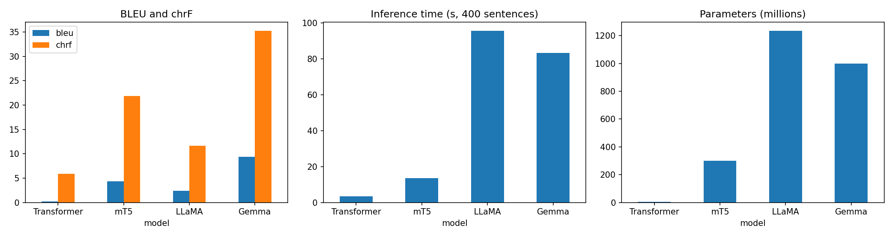
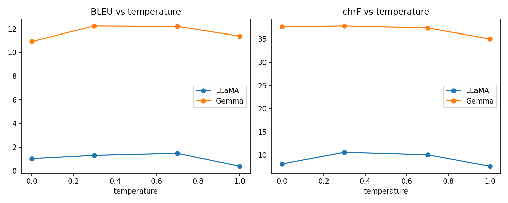

# English → Hindi Machine Translation: Basic Transformer vs mT5 vs LLaMA vs Gemma

**Course:** ICT4403 – Foundations of Generative AI, Assignment 3 (IA3)
**Student:** Varun Bramhankar (230953538)

## 1. Problem statement and objective

Build and compare four machine-translation systems for **English → Hindi** on the same test set:

| # | Model | Architecture | Adaptation used |
|---|---|---|---|
| 1 | Basic Transformer (built in PyTorch) | Encoder–decoder | Trained from scratch |
| 2 | `google/mt5-small` | Encoder–decoder | Full fine-tuning |
| 3 | Llama 3.2 1B Instruct | Decoder-only | Few-shot prompting (no fine-tuning) |
| 4 | `google/gemma-3-1b-it` | Decoder-only | Few-shot prompting (no fine-tuning) |

Models are compared on BLEU, chrF, training/fine-tuning time, inference time and parameter count. The study also discusses architecture differences and responsible-AI concerns (bias, hallucination, cultural misrepresentation, sensitive content).

## 2. Dataset

- **Source:** Hindi-English Parallel Corpus on Kaggle: https://www.kaggle.com/datasets/vaibhavkumar11/hindi-english-parallel-corpus (the IIT Bombay English-Hindi corpus; 1,561,841 raw rows, columns `english`, `hindi`).
- **Cleaning:** removed missing/empty rows, duplicate pairs (and duplicates on either side), rows whose Hindi side has no Devanagari, and kept only pairs with 4–25 English words and 4–30 Hindi words. 540,605 valid rows remained.
- **Subset:** 4,000 pairs sampled at random with seed 42.

| Split | Pairs |
|---|---:|
| Train | 3,200 |
| Validation | 400 |
| Test | 400 |

The full raw CSV is not included (about 400 MB). Download it from the Kaggle link above. The split files are in `data/`.

## 3. Models and implementation

- **Basic Transformer:** 3 encoder + 3 decoder layers, d_model 256, 4 heads, feed-forward 512, tied embeddings, joint SentencePiece (unigram, 5,000 vocab) trained on the training set. AdamW, label smoothing 0.1, 40 epochs, best-validation checkpoint, greedy decoding.
- **mT5-small:** fine-tuned for 8 epochs (batch 16, lr 5e-4, fp32) with the prefix `translate English to Hindi:`; greedy decoding.
- **LLaMA:** Llama 3.2 1B Instruct in fp16, 3-shot prompt built from training pairs, greedy decoding. It was loaded from the public mirror `unsloth/Llama-3.2-1B-Instruct` (same weights as Meta's gated `meta-llama/Llama-3.2-1B-Instruct`, whose access request was still pending).
- **Gemma:** Gemma 3 1B IT in fp32 (to avoid fp16 numerical problems on a T4), same 3-shot prompt, greedy decoding.
- **Decoding and evaluation:** all models translate the same 400 test sentences with greedy decoding. BLEU and chrF use `sacrebleu` (default settings). Inference time is the total time for the 400 sentences on a Colab T4 GPU, including tokenization.

LLaMA and Gemma were **prompted, not fine-tuned**, so their training time is not applicable.

## 4. How to run

1. Open `FGAI_Assignment_3.ipynb` in Google Colab and select **Runtime → Change runtime type → T4 GPU**.
2. Install dependencies (first cell): `pip install -r requirements.txt`, or run the notebook's install cell.
3. Download the dataset from Kaggle and upload `hindi_english_parallel.csv` when the notebook asks. (Or skip the cleaning cell and use `data/train.csv`, `data/validation.csv`, `data/test.csv`.)
4. Run the cells in order: data preparation → shared helpers → Transformer → mT5 → Gemma/LLaMA → comparison plots → responsible-AI analysis.
5. Gemma is a gated model: accept the license at https://huggingface.co/google/gemma-3-1b-it and log in with a Hugging Face read token when prompted.

Colab's `/content` storage is temporary, so results are written to `FGAI_Assignment_3/` and zipped with the notebook's `backup()` helper.

## 5. Repository layout

```
├── FGAI_Assignment_3.ipynb
├── README.md
├── requirements.txt
├── data/            train.csv, validation.csv, test.csv
└── results/
    ├── predictions/ model translations, temperature runs, sample_translations.csv, sensitive_subset.csv
    └── evaluation/  per-model metrics (.json), results_table.csv, comparison.png, temperature.png, temperature_*.csv
```

## 6. Results (400-sentence test set)

| Model | Params | BLEU | chrF | Train / fine-tune time | Inference time (400 sentences) |
|---|---:|---:|---:|---:|---:|
| Transformer (scratch) | 5.2M | 0.23 | 5.92 | 111.5 s | 3.4 s |
| mT5-small (fine-tuned) | 300.2M | 4.31 | 21.84 | 710.9 s | 13.6 s |
| LLaMA 3.2 1B (3-shot) | 1,235.8M | 2.42 | 11.67 | N/A | 95.7 s |
| **Gemma 3 1B (3-shot)** | 999.9M | **9.36** | **35.26** | N/A | 83.4 s |



Absolute scores are low for every model. Reasons: only 3,200 training pairs, small (≤1B) models, and the IIT Bombay corpus contains loosely aligned, noisy pairs where the reference is often a paraphrase.

## 7. Model comparison

- **Pretraining dominates.** Gemma, with no training, beat mT5 fine-tuned on 3,200 pairs. mT5 beat the from-scratch Transformer by about 4 BLEU and 16 chrF. The gaps follow how much language knowledge each model started with.
- **Encoder–decoder vs decoder-only (cost).** mT5 needed about 12 minutes of fine-tuning but translated 400 sentences in 13.6 s. The decoder-only models need no training but took 83–96 s, because they are 3–4× larger, process a few-shot prompt for every sentence, and (Gemma) ran in fp32. Gemma's inference time is therefore not strictly comparable with LLaMA's fp16 time.
- **Model size.** The 5.2M Transformer is far too small and under-trained to learn translation from 3,200 pairs. mT5-small's 300M parameters are largely its multilingual embedding table. LLaMA is the largest model but not the best.
- **Tokenization.** The Transformer uses a small joint SentencePiece vocabulary learned from 6,400 sentences. mT5 uses a large multilingual SentencePiece vocabulary. LLaMA and Gemma use their own large pretrained tokenizers. Devanagari text generally takes more tokens in a vocabulary dominated by Latin scripts, which lengthens generation.
- **Adaptation method.** Training from scratch needs far more data. Full fine-tuning adapts well but costs time. Few-shot prompting is free of training cost but is sensitive to the prompt. LLaMA's outputs show this: many were unrelated to the input, and some English source text was copied through. In the keyword subset, about a third of its outputs were unrelated or untranslated, which appears to be the model repeating its few-shot examples rather than translating. LLaMA's score therefore reflects 3-shot prompting of a 1B model and is not a general verdict on Llama 3.2.

## 8. Sampling-temperature analysis

Run on the first 100 test sentences, one run (seed 42) per temperature, with `top_p=1.0`, `top_k=0`. Temperature 0.0 means greedy decoding. These greedy numbers differ from the full-test results because they use only 100 sentences.

| Temperature | Gemma BLEU | Gemma chrF | LLaMA BLEU | LLaMA chrF |
|---:|---:|---:|---:|---:|
| 0.0 | 10.95 | 37.66 | 1.05 | 8.08 |
| 0.3 | 12.25 | 37.82 | 1.33 | 10.62 |
| 0.7 | 12.21 | 37.39 | 1.50 | 10.08 |
| 1.0 | 11.39 | 35.02 | 0.39 | 7.56 |



Both models degrade at temperature 1.0, and LLaMA nearly collapses. A hotter distribution lets low-probability tokens through, and errors compound over long Devanagari sequences. The small gain at 0.3–0.7 is probably within noise (100 sentences, one seed), so low-to-moderate temperature gives no clear benefit over greedy decoding for translation.

## 9. Responsible-AI analysis

Based on `results/predictions/sample_translations.csv` and `sensitive_subset.csv` (53 test sentences matching gender, religion, authority and violence keywords).

**Degenerate and hallucinated output.** The proxy below flags outputs shorter than half or longer than twice the reference length. It catches runaway or truncated output, but not fluent wrong content, so it understates mT5's real problem.

| Model | >2× ref length | <0.5× ref length | Flagged (of 400) |
|---|---:|---:|---:|
| Transformer | 118 | 108 | 226 |
| mT5 | 16 | 13 | 29 |
| LLaMA | 26 | 91 | 117 |
| Gemma | 6 | 10 | 16 |

**Examples.**
- *Hallucination:* "St. Francis Church, Kochi" became "नर्मदा स्कूल, नागालैंड" (mT5); an arrest sentence became one about death and bail (mT5); Gemma translated "rabbits" as "हिरणों" (deer).
- *Cultural misrepresentation:* "the Holy Mother" (Sarada Devi in the reference) became "पवित्र मातृत्व" (mT5) and "संत माता" (Gemma). "He attained martyrdom" became "वह मृत्यु के क्षेत्र में पहुँच गया" (Gemma), losing the concept of शहादत.
- *Sensitive/legal content:* a historical arrest was rewritten with invented details (mT5) or garbled names and a swapped location (Gemma).
- *Bias and gender:* the test set contains little clearly gendered content, so evidence is limited. Observed: honorifics lost or garbled (for example "Swamiji"), names distorted, and pronoun referents resolved loosely.
- *Format leakage:* Gemma sometimes added "ज़रूर, यहाँ अनुवाद है:" or "अंग्रेजी:", and stray characters from other scripts.

**Mitigations.** Human review for high-stakes text (legal, medical, news, religious); automatic checks (length ratio, script mix, untranslated-text detection) and confidence flags; glossaries for names, places and religious terms; better prompts or LoRA fine-tuning to stop example-copying and boilerplate; output cleaning; cleaner, more diverse training data; and clear disclosure that the text is machine-translated.

## 10. Conclusion

**Gemma 3 1B (few-shot) is the best model** (BLEU 9.36, chrF 35.26), and it is also the most faithful by the length-ratio check. mT5-small is the best trade-off between quality and speed (second-best scores, 6× faster inference than the decoder-only models). The from-scratch Transformer failed to learn translation from 3,200 pairs, and LLaMA, as prompted here, was unreliable. No model is safe to use unreviewed for sensitive or high-stakes translation.

## 11. Limitations

Single run per setting (no seeds or error bars); small test set (400); few-shot prompts not tuned; Gemma ran in fp32 and LLaMA in fp16; noisy reference translations; LLaMA loaded from a mirror; temperature analysis on 100 sentences only.

## References

- Kunchukuttan, A., Mehta, P., Bhattacharyya, P. (2018). *The IIT Bombay English-Hindi Parallel Corpus.* LREC 2018.
- Xue, L. et al. (2021). *mT5: A massively multilingual pre-trained text-to-text transformer.*
- Meta AI, *Llama 3.2*; Google DeepMind, *Gemma 3*.
